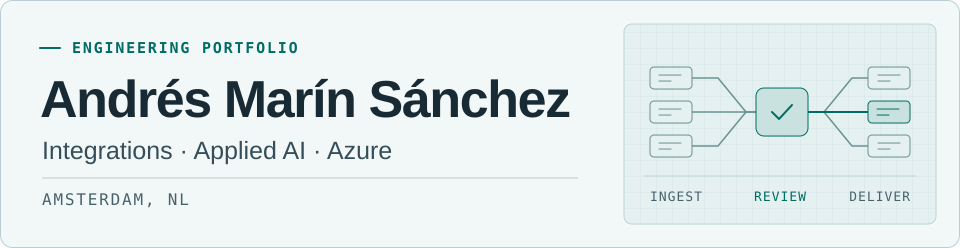

<picture>
  <source media="(prefers-color-scheme: dark)" srcset="./assets/profile-dark.svg">
  
</picture>

I build integrations and data workflows for teams that need to move records between systems, review exceptions, and trace what was delivered.

[Project stories](#project-stories) · [More tools](#more-tools) · [LinkedIn](https://www.linkedin.com/in/amarin9125/)

## Project stories

### 01 · Regulatory data exports for financial institutions

I built [Avro Partition Writer](https://github.com/andres9125/avro-partition-writer) while working on MURIC credit portfolio reporting for the Superintendencia Financiera de Colombia. The reusable .NET component rotates large exports into independently readable Avro files. It handles file generation within the wider reporting workflow.

`C#` `.NET 8` `Apache Avro`

[Run the demo](https://github.com/andres9125/avro-partition-writer#run-the-rotation-demo) · [MURIC regulatory context](https://www.superfinanciera.gov.co/publicaciones/10116149/modulo-unico-de-reporte-de-informacion-de-cartera-muric/)

### 02 · Bilingual publishing for editorial teams

I built the website and its publishing workflow so editors could work in Notion while reviewers could inspect proposed changes in a pull request. The case study follows a change from editorial approval to deployment on Vercel and verification in both languages.

`Notion` `Git` `Vercel`

[Read the case study](https://www.eximus-software.com/en/case-studies/software-modernization/notion-publishing-reviewed-traceable-delivery)

### 03 · Ledger migration for property operations

[Ledger Import Review](https://github.com/andres9125/ledger-import-review) is a runnable demo for teams onboarding property ledger data. It validates a synthetic CSV export, separates exceptions, and offers optional local AI suggestions for unfamiliar statuses. Reviewers decide how to resolve each exception.

`Python` `CSV` `Ollama (optional)` `GitHub Actions`

[Run the demo](https://github.com/andres9125/ledger-import-review#run-the-demo)

## More tools

| Repository and stack | Built for |
| --- | --- |
| [Azure DevOps Board as Code](https://github.com/andres9125/azure-devops-board-as-code) `PowerShell` `Azure DevOps REST API` | Delivery teams can preview and apply consistent team and board configuration across Azure DevOps projects. |
| [GX Migration Toolbox](https://github.com/andres9125/gx-migration-toolbox) `Python` `GeneXus` `Static analysis` | Modernization teams can inventory generated GeneXus source and spot platform dependencies before planning a migration. |
| [Jira Markdown KB](https://github.com/andres9125/jira-markdown-kb) `Python` `Jira Cloud REST API` `Markdown` | Teams handing over or archiving projects can export Jira epics and issues into a portable Markdown knowledge base. |
| [Dev Docker Stacks](https://github.com/andres9125/dev-docker-stacks) `Docker Compose` `PowerShell` `SQL Server` `MySQL` `Tomcat` `.NET` | Developers can bring up consistent local environments for applications that depend on SQL Server, MySQL, Tomcat or .NET. |
| [Graphic Toolkit](https://github.com/andres9125/graphic-toolkit) `Python` `Pillow` `OpenAI Images (optional)` | Web teams can regenerate favicons, brand assets and social cards from a single source image. |

- [OpenClaw fork](https://github.com/andres9125/openclaw) · Upstream personal AI assistant for developers and self-hosters · `TypeScript` `Node.js`
- [Profile source](https://github.com/andres9125/andres9125) · Portfolio index and artwork · `Markdown` `SVG`
